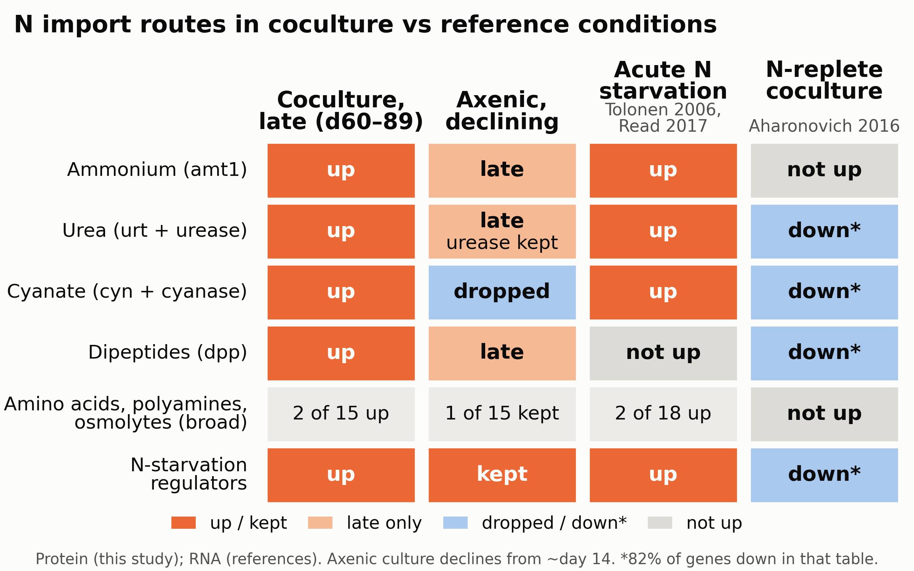

# Nitrogen import capacity of *Prochlorococcus* in coculture with *Alteromonas*

*Working paper — grows across the analysis arc. Sections fill in at the Plan commit and each Run
milestone's decide phase.*

## Question

In long-term nitrogen-limited coculture with *Alteromonas macleodii* HOT1A3, for which classes of
nitrogen compounds does *Prochlorococcus* MED4 raise its import capacity beyond what early axenic
nitrogen starvation shows? Is that pattern specific to nitrogen limitation, i.e. absent in
nitrogen-replete cocultures of MED4 and of other *Prochlorococcus* strains?

This is the consumer-side half of a question about which nitrogen compounds *Alteromonas* passes
to *Prochlorococcus*. The producer side (*Alteromonas*) is a separate analysis, and a third
compares the two. Transporter expression measures import capacity, which is largely set by
nitrogen-starvation regulation. It does not show that a compound was present, taken up, or
supplied by the partner.

## Background

*(Draft material for the rewrite of Weissberg et al. 2025, bioRxiv 10.1101/2025.11.24.690089.
The preprint's interpretations are treated as hypotheses to re-examine, not as established.)*

In coculture with *Alteromonas* HOT1A3, *Prochlorococcus* MED4 survives for months after the
nitrogen in its medium is exhausted, whereas axenic cultures die. The preprint interpreted the
accompanying proteomes and transcriptomes as MED4 up-regulating high-affinity nitrogen
scavenging while *Alteromonas* recycles organic matter and supplies low-level ammonium. No
measurement of nitrogen compounds exists for these cultures, so which compounds are exchanged can
only be inferred from the organisms' gene expression.

MED4's genome encodes import routes for ammonium (`amt1`), urea (`urtA–E` with urease), cyanate
(`cynABD` with cyanase) and peptides (`dpp`), and has no nitrate or nitrite assimilation. Its
transporter annotation names specific importers for only some nitrogen classes. Amino acids,
polyamines and osmolytes are reachable only through broad family-level annotation.

The data are the per-culture starvation time courses: protein and RNA, in coculture and axenic,
each compared with its own exponential phase, extending to day 89 in coculture. Earlier coculture
transcriptomes of MED4 and MIT9313 with HOT1A3 (Aharonovich & Sher 2016) and of NATL2A with
*Alteromonas* MIT1002 (Biller et al. 2016) were all taken in nitrogen-replete exponential growth,
and serve here as controls.

## Methods

**Data source.** All annotation came from the multiomics knowledge graph (KG release 0.1.0-alpha.7,
built 2026-09-22; `multiomics_explorer` 0.1.0-alpha.5) through its Python API. Every call went
through a fetch helper that makes single unpaged calls, asserts that returned rows equal
`total_matching`, and checks for duplicate natural keys. Paging was abandoned after an
API-usage review showed that offset paging over a non-unique sort order silently duplicated and
dropped rows while totals still matched.

**Transport systems, built per strain.** For *Prochlorococcus* MED4, MIT9313 and NATL2A
separately, transporter genes were collected from four sources: TCDB family attachments, the
KEGG BRITE transporter catalogue, Pfam domains with a transporter role, and curated Cyanorak
transport roles (Q.1–Q.9). A gene missed by all of these was re-queried with the full role map. Subunit roles (substrate-binding, permease, ATPase,
single carrier) were assigned from Pfam domains through a role map learned from the transporter
genes themselves; each domain's role is reviewable with the rule that set it. Genes were grouped
into systems by genome position (same-strand runs, adjacent gap ≤ 200 bp) and by shared TCDB
family. Directly adjacent same-strand ABC parts that share the ABC superfamily were also joined,
including a second permease or a membrane-fusion protein (e.g. `devBCA`, `evrABC`), but two
complete cassettes were never merged. Pieces of an incomplete ABC system at different loci were
joined when they shared a TCDB subfamily and had complementary roles; pieces made only of non-transport genes were not allowed
to join. No ortholog mapping was used: each strain's systems come from its own annotation.

**Substrates.** For each system, every substrate in its TCDB annotation was listed with flags,
with no prefiltering (MED4: 14,978 rows; MIT9313: 27,013; NATL2A: 17,022). The flags record:
- whether the substrate is listed for the gene's own TCDB subfamily or inherited from a parent
  family;
- the evidence behind the TCDB call;
- whether the family is a catch-all superfamily (ABC 3.A.1, MFS 2.A.1, 2.A.7, 2.A.6, and in
  MIT9313 2.A.66, each listing ≥ 100 compounds);
- whether the compound is a ubiquitous cofactor;
- whether it contains nitrogen.

A substrate was marked usable if some gene of the same strain has a KEGG reaction on it. Because
the KG stores the same compound under unconnected IDs (nitrate as both ChEBI 14654 and KEGG
C00244), compounds were matched through equivalence groups, with name-only links flagged.

**Linked enzymes.** Two kinds of enzyme were linked to a system, both requiring a KEGG reaction on
a compound the system carries (catch-all families and cofactors excluded):
- *neighbour-linked*: the enzyme lies within ±8 genes on either strand, and the compound is not
  ubiquitous (≥ 30 reacting genes, i.e. ammonia and glutamate, cannot create the link);
- *function-linked*: the enzyme shares a curated Cyanorak functional role with the system (other
  than a transport role), at any distance. For ubiquitous compounds, only glutamine synthetase
  and GOGAT (EC 6.3.1.2, 1.4.7.1) count.

**Confidence tiers.** Each system was assigned a tier from whether it is a credible transporter
and complete, not from the sequence-evidence type of its TCDB call. That choice matters because
direct sequence hits are rarer for multi-subunit ABC systems (40% vs 57% of single-gene systems
in MED4), so keying the tier on hit type would penalise ABC systems.
- *High*: transporter-role domain, KEGG transporter KO, or curated Cyanorak transport role on a
  TCDB-listed gene; plus all required subunits present; plus a specific TCDB call.
- *Medium*: the same, but missing a required subunit.
- *Low*: placed only in a catch-all superfamily, supported only by zero-score TCDB hits, or listed
  in TCDB with no supporting domain, KO or curated role ("catalogue-only"). A curated Cyanorak
  transport role lifts the first two cases to Medium, never the third. Most systems lifted this way
  are annotated as efflux or export proteins. They carry an `efflux_annotated` flag.

A KEGG transporter KO or a curated Cyanorak transport role counted as transporter evidence only
for genes TCDB also lists. Known false positives are flagged rather than removed: ferritin,
glutathione S-transferases (TCDB-listed in the CLIC family), a MAPEG glutathione protein and
`sodX`.

**Compound classes.** Substrates were grouped into ammonium, urea, cyanate, nitrite, nitrate,
amino acids, peptides, amines, polyamines, nucleobases/nucleosides and osmolytes by curated
name rules. KEGG pathway membership and the carrying transporter family were tried as classifiers
and rejected: about half of the sampled assignments were wrong (e.g. thyroxine as an amino
acid). They are kept as context only. TCDB substrate lists describe a whole subfamily, not
the individual gene: the sulfate permeases `sul1`/`sul3` list amino acids and nitrate, and K⁺/Na⁺
transporters (`ktrAB`, `nhaS`) list ammonium. Each system's listing of a nitrogen class was therefore
marked *dedicated* when a member's product or gene name names the class, or when a curated Cyanorak
amino-acid/nucleoside role agrees (not for efflux-annotated systems). Otherwise it was marked a
*broad listing*. A dedicated listing means the annotation names the class, not that the gene
transports it. **These classes are best effort: the KG holds no chemical
classification of metabolites (no ChEBI class hierarchy), and 382–422 nitrogen-containing
substrate groups per strain remain unclassified.**

**Verification.** The construction was checked step by step on seven MED4 cases (the cyanate,
urea/urease, ammonium, peptide (split across three loci) and phosphate systems, plus two noise
cases) against an independent answer key, built by a separate agent through the KG's query
interface without seeing the code. It was then reviewed twice for API usage and twice by a
fresh-context critic. Before approval, a further set of checks was run:
- gene maps of every nitrogen-relevant locus;
- recall of curated transporter genes;
- a random sample of each tier;
- agreement between listed substrate and product description;
- sensitivity to the grouping gap (100/200/500 bp; nitrogen systems identical);
- consistency of shared transporters across strains.

These checks led to the adjacent-ABC rule, the fourth gene source and the dedicated/broad split
above. A third critic pass then reviewed these changes. The nitrate/nitrite expected-negative holds
per genome:
- nitrate is unusable in all three strains (no gene reacts with it);
- nitrite is usable only where nitrite reductase is present: MIT9313 and NATL2A, each with the
  FNT nitrite transporter `focA` adjacent to `nirA`.

## Results

*Draft from the analysis milestone; the evaluation milestone may revise it. Numbers are rank
percentiles within each experiment (1.0 = the most up-regulated gene) and the source papers'
significance calls. Details and figures: `analysis/notebook.md`, `analysis/figures/`.*

**Data checks.** All 13 planned experiments were retrieved complete, and ten values were confirmed
by an independent query. Two features of the tables shape every reading:
- Significance in the anchor tables also requires |log2FC| ≥ 1.
- The coculture-vs-axenic RNA contrasts are algebraically linked. The axenic sample, taken around
  day 14 and already in late decline, serves as the reference for coculture day 18.

**Pre-registered checks** (reported before the results, as planned):

| Check | Outcome |
|---|---|
| Biology sanity gate | Pass in protein (15/15) |
| Calibration C1 / C2 / C3 | Pass / **fail** / **fail**, so no compound is named |
| C4, acute starvation | Tolonen pass under a relaxed rule; Read fail |
| P1 (blind): `amt1` RNA top 10% at d60 and d89 | **Fail** (0.06, 0.66). Caveat: the RNA reference is N-stressed |
| P2 (blind): `amt1` RNA ≥ urea/cyanate systems | Fail at d60, pass at d89 |
| Expected-negative 1: nitrate/nitrite unusable | Pass |
| Expected-negative 2: no N system up in N-replete coculture | MED4 pass; NATL2A pass; **fails in one MIT9313 culture** (`natF`) |
| Expected-negative 3: no non-N system stands out | Pass |

The pre-registered class labels were **not applied**. The axenic reference turned out to be a
late-decline culture, so the labels were deferred to the contrast analysis. This is a disclosed
deviation (analysis decisions 4–5).

**N-starvation sanity check.**
- In protein, glutamine synthetase (`glnA`), `ntcA` and PII (`glnB`) are significantly up at every
  coculture day and in the axenic sample (15/15 tests).
- In coculture RNA they are down.
- Each culture's RNA is measured against its own exponential-phase sample (day 11). The coculture's
  N-regulon RNA was already well above axenic then: `glnA` +2.4, `cynA` +3.1, `urtA` +2.5 log2FC.
  This contributes to the protein-up / RNA-down pattern.
- After exponential growth the coculture RNA changes little: 84 significant genes at day 18, against
  877 in the axenic culture at day 14. Coculture-vs-axenic RNA differences at that stage mainly
  reflect the axenic culture's decline.

**Import systems don't report their substrate.** In MED4 growth experiments with a single N source
(Tolonen et al. 2006):
- the urea system is not up on urea (median rank 0.34), but `urtA` is up on cyanate;
- on cyanate, only `cynA`, `urtA` and `glnA` are significant.

In MIT9313, the nitrite system (`focA`/`nirA`) and the urea system are both near the top on both
nitrite and urea (≥ 0.98). The pre-registered substrate-calibration gate failed, so no compound is
named from the *Prochlorococcus* side. The ammonium transporter `amt1` was not calibrated.

**MED4 in long coculture.**
- **Sustained in coculture.** In protein, the ammonium (`amt1`), urea (urt with urease) and cyanate
  (cyn with cyanase) systems are in the top 10% through day 89 (`amt1` from day 31; it lags at day 18). They cluster with the
  published N-starvation gene set, which stays at 0.91–1.00.
- **Lost in the dying axenic culture.** There, the urea and cyanate systems fall back (urt 0.79 →
  0.48–0.57; cyn 0.99 → 0.67–0.72) while the N-stress regulators stay at 0.93–0.98.
- **No detectable damping.** Within coculture, damping can't be detected at the rank ceiling. Late
  marker fold changes are mixed: `ntcA` eases, `glnB` rises.
- **dpp is unresolved.** The dipeptide system is raised in coculture protein (0.82–0.89), but in the
  axenic culture's own protein `dppA` does not rise.
- **No other route.** No broadly annotated route shows its transporter and consuming enzymes rising
  together (exploratory). Among peptidases, C–N hydrolases and ammonia-lyases, none rises in
  coculture without also rising in the axenic culture or in acute starvation, except one signal
  peptidase.

**Envelope and iron.**
- Genes up in late coculture protein but not in any axenic sample or in acute N deprivation:
  - the lipid II flippase `murJ`;
  - `tolC`, `acrA` and `bamA` (already high in the axenic day-14 sample).
- The porin `som` is also up in the dying axenic culture.
- An iron-starvation gene cluster is modestly raised in coculture protein only (0.71–0.77 vs 0.52).

**Provisional reading.** MED4 raises and sustains its capacity to take up and process ammonium,
urea and cyanate as part of the N-starvation response; expression cannot name the compound used.
Dipeptide import is raised but unresolved. No other nitrogen route shows a coculture signal beyond
starvation. Because the axenic comparison is with a declining culture, these contrasts do not
separate a partner effect from survival, and "no signal" is not evidence that no other compound is
taken up.

## Discussion

*Draft from the evaluation milestone (`evaluation/notebook.md`), revised after its critic.*

**What the consumer side shows.**
- Over 89 days of N-limited coculture, MED4 keeps the proteins of its ammonium, urea and cyanate
  import systems and their processing enzymes among its most up-regulated, together with the
  N-stress regulators (`glnA`, `ntcA`, `glnB`). The ammonium transporter joins later than the others.
- This pattern is expected whenever MED4 stays N-stressed, whether a partner supplies too little
  nitrogen to relieve it or none at all. Partial relief with damped alternative-N systems could
  not be tested well: the systems sit at the rank ceiling, and no partial-supply calibration exists.
  A few weak signals point toward partial relief: `ntcA` protein eases late, protein-synthesis genes
  recover partway, and P2 passes at day 89.
- In the axenic culture, which declines and dies within weeks, the urea and cyanate systems fall to
  mid-rank. The ammonium transporter, urease and the regulators stay high. The ammonium
  transporter rises over time in both cultures, which fits a starvation-length effect.
- Every axenic sample is a declining culture, so the analysis can't tell whether the partner causes
  MED4 to keep its import machinery, or simply keeps MED4 alive.

**What it cannot show.**
- Expression of these systems does not show whether, or which, nitrogen compound is supplied. In
  growth experiments with a single N source:
  - the urea system did not respond to urea, and rose on cyanate;
  - in MIT9313 the urea and nitrite systems rose on both substrates;
  - the cyanate system was specific in its one test, but the gate fails on the urea system.
- `[interpretation]` Shared NtcA control is the likely reason. Transporter and processing enzyme
  rising together (urt with urease, cyn with cyanase) is expected from that shared control, and is
  not independent evidence of use.
- The blind test of the ammonium transporter's RNA failed. The RNA reference was itself N-stressed,
  so this is weak evidence either way.
- As pre-registered, no compound is named from the *Prochlorococcus* side.

**No coculture-specific N route.**
- No nitrogen route is up in coculture without also being up in some axenic sample or in acute
  starvation.
- The dipeptide transporter is raised in coculture protein, but its subunits disagree and `dppA` does
  not rise in the axenic culture's own protein, so it stays unresolved.
- The broadly annotated routes (amino acids, polyamines, osmolytes, amino sugars) show nothing beyond
  starvation.

This is a post-hoc criterion. The pre-registered falsifiability check ("no class stands out") could
not be evaluated because the labels were deferred. Under the rules adopted for later, the ammonium
and urea systems would pass the first two criteria, but only against a dying reference. Neither
reading is proof about use: uptake needs no induction, and several routes are thinly annotated.

A small set of cell-envelope and membrane genes is up in coculture but not in any axenic sample or
in acute starvation:
- the lipid II flippase `murJ`;
- `tolC`, `acrA`, `bamA`, `perM` and `mgtE`, most of which were already high early in the axenic
  culture.

Their role in the interaction is open.

**Implications for the preprint.**
- The reading that MED4 "up-regulates high-affinity nitrogen scavenging" holds in protein, as
  maintenance of the N-starvation response.
- It does not hold in RNA, and "high-affinity" was not tested.
- It is not evidence that *Alteromonas* supplies a particular compound, or any compound. The
  consumer side gives no positive support to the ammonium-supply interpretation.
- That interpretation must rest on the producer side and the contrast analysis.

**Limitations.**
- The axenic references are late decline or death.
- RNA references differ between cultures.
- Significance follows the source papers' calls (with a fold-change cutoff).
- Substrate annotation is per subfamily.
- The pre-registered labels and falsifiability check were not applied.
- No nitrogen compounds measured in the coculture are in the knowledge graph.

The full list is in `evaluation/notebook.md`.

## Conclusion

**What we tested.** We built MED4's 73 transport systems from its own annotation and read their
protein and RNA through 89 days of N-limited coculture with *Alteromonas*. We compared them with
three kinds of reference:
- the axenic culture of the same study (already declining by day 14);
- acute N starvation (Tolonen 2006: N deprivation, and growth on cyanate or urea; Read 2017: N-depleted RNA-seq, 3–24 h);
- N-replete cocultures (Aharonovich 2016; Biller 2016).

**What was up in coculture** (protein; rank 1.0 = most up-regulated gene; figure: `analysis/figures/e16_conclusion.png`):

| N route | Coculture (d18–d89) | Axenic (declining, d14–d89) | Acute N starvation: Tolonen 2006 / Read 2017 | N-replete coculture |
|---|---|---|---|---|
| Ammonium (`amt1`) | Up from day 31; top 2% by day 60 (0.98) | Not up at d14–d31; up at d89 (death) | Up / up (3 h) | Not up |
| Urea (urt + urease) | Up; top 1–7% | urt dips (down at d31, 0.57 at d89); urease stays up | Up / up (12–24 h) | Not up |
| Cyanate (cyn + cyanase) | Up; top 1% | Up at d14, then mid-rank (0.67–0.71) | Up / up (12–24 h) | Not up |
| Dipeptides (dpp) | Up (`dppA`, `dppC`; 0.82–0.89) | Only `dppC`, late (system rank 0.34) | Not up / not listed | Not up |
| Amino acids, polyamines, osmolytes (broad listings) | No consistent signal | No signal | Not up / 2 of 22 up at 24 h | Not up |
| N-starvation regulators (`glnA`, `ntcA`, `glnB`) | Up | Up | Up / `glnA`, `ntcA` up | Not up |

**What it means:**
1. MED4 runs a full N-starvation response throughout the coculture. Its ammonium, urea and cyanate
   import machinery stays among its most abundant proteins for 89 days.
2. These are the systems that acute N starvation switches on and that N-replete coculture does not.
   The coculture response matches N limitation rather than a general partner effect.
3. The coculture keeps the cyanate system that the declining axenic culture drops. In the axenic
   culture the ammonium and urea transporters come up only late, in death phase; urease stays up.
4. Dipeptide import is raised in coculture; in the dying axenic culture only one subunit rises, late.
5. No amino-acid, polyamine or osmolyte route responds.

**What it can't tell us.** The import systems don't report their own substrate. In calibration
experiments the urea system rose on cyanate, not on urea. So expression can't name the compound MED4
takes up. That question goes to the *Alteromonas* analysis.

Caveats in brief:
- the axenic culture is declining, so "kept in coculture" may also mean "kept alive";
- RNA is measured against a reference that was already N-stressed in coculture;
- the pre-registered class labels were deferred.

Details: Discussion and `evaluation/notebook.md`.

## References

- Weissberg O, Aharonovich D, Sher D (2025). Transcriptomic and Proteomic Analysis Reveals
  Nitrogen Recycling as a Core Mechanism for *Prochlorococcus* Prolonged Survival. bioRxiv.
  doi:10.1101/2025.11.24.690089
- Aharonovich D, Sher D (2016). Transcriptional response of *Prochlorococcus* to co-culture with
  a marine *Alteromonas*: differences between strains and the involvement of putative
  infochemicals. ISME J. doi:10.1038/ismej.2016.70
- Biller SJ, Coe A, Chisholm SW (2016). Torn apart and reunited: impact of a heterotroph on the
  transcriptome of *Prochlorococcus*. ISME J. doi:10.1038/ismej.2016.82
